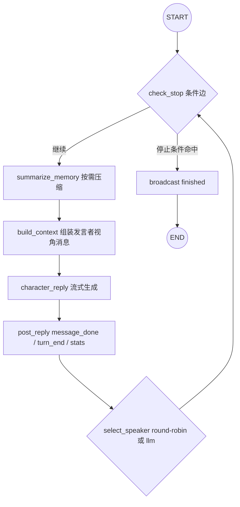
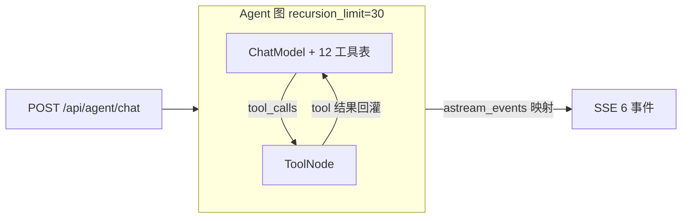

# DEV PLAN · duet-langgraph（Python + LangGraph 重构版）

> 状态：**待施工**（2026-10-09 定稿；2026-10-15 按新拍板口径修订为「本仓库分支重构」）
> 产物形态：本仓库（duet）的 `langgraph` 长期施工分支；施工完成后合并回 master，TS 版（`server/`）删除。
> 施工日志：本仓库分支上的 `docs/DEV_LOG_LANGGRAPH.md`（每阶段门禁时追加）。

---

## 修订记录

### 2026-10-15 仓库形态变更（推翻原 D1，用户重新拍板）

**原决策**：独立新仓库 `github.com/honlnk/duet-langgraph`，前端 vendored 拷贝，TS 版仓库保留作对比叙事。

**新决策**：在本仓库 `langgraph` 分支上直接重构，TS 与 Python 两套后端施工期并存（`server/` + `server-py/`），web/ 共享；Python 版 S5 验收全过后删除 TS 版，合并回 master。

**理由**（用户陈述）：

1. 底层能力（手写协议适配器等）由用户其他项目证明，本项目无需承担对比叙事职责；
2. 一个项目只留一套代码，避免双仓库维护；
3. master 在重构完成前保持不变（冻结），施工全程在分支上进行。

**连带变更**：

- 原 D1（仓库形态）整体替换为新 D1（见 §2）；
- 原 §7「sessions 不迁移」的后果描述从「两仓库各看各的」改为「升级后旧会话不可恢复」，需写入 README 升级说明（见 §7）；
- 原 §10「pacing 不做」与 §11 R1/R2 的「降级」口径统一改为「调研项」：施工时先探针实测，做得到就做，做不到在 README 差异清单显式标注（见 §10、§11）；
- 新增阶段 S6「清理 TS 版」（见 §8）；
- 施工日志从新仓库 `docs/DEV_LOG.md` 改为本仓库分支 `docs/DEV_LOG_LANGGRAPH.md`。

---

## 1. 背景与目标

duet 的 TS 版后端是一套零 SDK 的手写实现（四协议适配器、手写 agent loop、JSON 落盘会话）。本计划将其后端用 **Python 3.12 + FastAPI + LangGraph** 重写，前端 `web/` 原样复用，目标是：

1. 产出一个能正面命中招聘 JD 关键词（Python / LangGraph / Agent / multi-agent / memory / checkpointer）的可演示项目；
2. 用框架解法补齐手写版明确做不动/没做的部分（模型驱动调度、上下文管理、重试）；
3. 项目最终只保留一套 Python 实现，TS 版在验收通过后删除（git 历史与 `final-ts` tag 保留）。

非目标（不做的原因见 §10）：不追求功能 100% 对齐（差距显式列清单）；施工期不触碰 master。

## 2. 已拍板决策（施工方不得更改，改动需回用户重新拍板）

| # | 决策 | 内容 |
|---|---|---|
| D1 | 仓库与分支形态 | 本仓库 `langgraph` 长期分支施工，master 冻结至 S5 验收通过。仓库根新增 `server-py/`（uv 工程，pyproject.toml + uv.lock 自包含于子目录，不进根 pnpm workspace）；`server/`（TS）施工期原样保留；`web/` 共享。S6 阶段删 `server/` 并合并 master，删除前打 `final-ts` tag |
| D2 | 协议层 | **不再手写协议适配器**，四协议全部交给 langchain 官方 model 类（见 §5.3 映射表）。方言级透传缺口先 `model_kwargs` 兜底；兜不住的（如 DeepSeek thinking、openai-responses 形态）按 §11 调研项流程处理，不预先判死刑 |
| D3 | 调度 | 默认 `round-robin`，行为与 TS 版一致；session 级新增可选 `scheduling: "llm"`（模型驱动选下一个发言者），默认关闭。前端无需感知 |
| D4 | 参数默认值 | 与 TS 版对齐：`maxTokens=1024`、会话级 temperature、`requestTimeoutMs=30000`、重试指数退避最多 10 次（1s 起上限 60s）、全局熔断 200 轮 / 7200s、摘要窗口 keepRecent=8 / summaryEveryN=10（出处：`server/src/config.ts`、`ws/chatHandler.ts`） |
| D5 | 端口与数据 | 端口 23892 不变（施工期 Python 版占用，TS 版不同时起或手动挪 PORT）；`DATA_DIR` 逻辑照搬（显式 env 最优先 → 默认 `~/.duet-langgraph`）；`providers.json` / `library.json` 文件格式 100% 兼容 TS 版 |
| D6 | 汇率 | 照搬 TS 版：httpx 抓 `https://open.er-api.com/v6/latest/USD`，内存缓存 + 陈旧降级（出处：`routes/exchange.ts`） |
| D7 | 交付 | PyPI 包 `duet-langgraph`（控制台入口 `duet-langgraph`）+ Docker 多阶段镜像（非 root、HEALTHCHECK `/api/health`、compose 一键起）。发版 CI：S6 删除 npm 发布流水线（`release-npm.yml`），替换为 PyPI 发布（tag 触发模式照抄）。npm 已发布的 `@honlnk/duet` 版本不动、自然停止更新 |
| D8 | LangSmith | env 开关可选启用（`LANGSMITH_TRACING=true`），不在验收范围内 |

## 3. duet TS 版接口面事实（前端复用的契约，施工的唯一事实来源）

以下均已在源码核对（2026-10-09）。施工时以 TS 源码为准重新核对一遍（注意：定稿后 TS 版发过 v1.0.1，需确认契约无漂移），发现与本文不符时以源码为准并记入施工日志。

### 3.1 REST 路由全集

| 路由 | 方法 | 出处 |
|---|---|---|
| `/api/health` | GET | `routes/health.ts` |
| `/api/config/limits` | GET | `routes/health.ts` |
| `/api/sessions` | POST / GET | `routes/sessions.ts` |
| `/api/sessions/:id` | GET / DELETE | `routes/sessions.ts` |
| `/api/providers` | GET / POST | `routes/providers.ts` |
| `/api/providers/:id` | PUT / DELETE | `routes/providers.ts` |
| `/api/providers/default/:id` | PUT | `routes/providers.ts` |
| `/api/providers/models` | GET | `routes/providers.ts` |
| `/api/providers/:id/models` | GET | `routes/providers.ts` |
| `/api/providers/thinking-options` | POST | `routes/providers.ts` |
| `/api/providers/:id/thinking-options` | POST | `routes/providers.ts` |
| `/api/pricing/:modelId` | GET | `routes/pricing.ts` |
| `/api/exchange-rates` | GET | `routes/exchange.ts` |
| `/api/templates/characters` | GET / POST | `routes/library.ts` |
| `/api/templates/characters/:id` | PUT / DELETE | `routes/library.ts` |
| `/api/templates/topics` | GET / POST | `routes/library.ts` |
| `/api/templates/topics/:id` | PUT / DELETE | `routes/library.ts` |
| `/api/templates/worldviews` | GET / POST | `routes/library.ts` |
| `/api/templates/worldviews/:id` | PUT / DELETE | `routes/library.ts` |
| `/api/relationships` | GET | `routes/library.ts` |
| `/api/relationships` | PUT | `routes/library.ts` |
| `/api/library/status` | GET | `routes/library.ts` |
| `/api/library/import` | POST | `routes/library.ts` |
| `/api/agent/chat` | POST（SSE） | `routes/agent.ts` |
| `/ws/chat?sessionId=...` | WebSocket | `ws/wsRoutes.ts` |

### 3.2 WS 协议（`ws/chat`）

C→S 共 4 种（`types/index.ts:540-544`）：

| type | 载荷 |
|---|---|
| `ping` | 无 |
| `start` | `maxRounds?`, `durationSec?` |
| `stop` | 无（优雅停止：等当前发言完整输出） |
| `reading` | `atBottom: boolean`, `bufferedRounds: number` |

S→C 共 15 种（`types/index.ts:546-681`，discriminated union）：

| type | 关键字段 | 备注 |
|---|---|---|
| `sync` | `session` | 连接时全量同步 |
| `started` | `startedAt` | 暂停后继续会被重置 |
| `chunk` | `characterId`, `content` | 流式片段 |
| `message_done` | `characterId`, `message` | 权威消息对象 |
| `summary` | `characterId`, `phase: start\|done\|error`, `summary?`, `message?` | 摘要三相 |
| `stats` | `totalPromptTokens` 等 9 字段**顶层展开** | 见 `types/index.ts:588-599` |
| `turn_end` | `round`, `messageCount` | |
| `error` | `message` | |
| `stopping` | 无 | 用户请求暂停、等当前发言完成 |
| `finished` | `reason` | 循环结束 |
| `pong` | 无 | |
| `retry` | `attempt`, `maxAttempts`, `delayMs`, `error` | 退避预报 |
| `director_added` | `director` | 导演指令（带轮次有效期） |
| `director_removed` | `directorId` | |
| `pacing` | `phase: waiting\|resumed` | 视窗跟随（调研项，见 §10、§11-R6） |

### 3.3 Agent SSE 协议（`POST /api/agent/chat`）

事件共 6 种（`routes/agent.ts:80-102`）：

| event | data 字段 |
|---|---|
| `delta` | `text` |
| `tool_call` | `name`, `args`, `summary` |
| `tool_result` | `name`, `ok`, `summary`, `mutated` |
| `assistant` | `content` |
| `done` | `reason`（含 `error`） |
| `error` | `message` |

### 3.4 Agent 工具清单（12 个，`agent/tools.ts`）

角色模板：`list_character_templates` / `upsert_character_template` / `delete_character_template`；话题模板：`list_topic_templates` / `upsert_topic_template` / `delete_topic_template`；世界观模板：`list_worldview_templates` / `upsert_worldview_template` / `delete_worldview_template`；关系：`list_relationships` / `set_relationship` / `delete_relationship`。

工具语义必须平移的三个设计：upsert 语义（id 空 = 新建）；`set_relationship` 校验失败时列出全部合法 id 帮模型自纠；任何工具失败转文本回灌而非抛出循环。

### 3.5 数据文件（`DATA_DIR` 下）

| 文件 | 内容 | 兼容策略 |
|---|---|---|
| `providers.json` | Provider 数组：`id/name/baseUrl/apiKey/model/protocol` + 价格与思考配置 | 字段 100% 兼容，可直接拷贝 |
| `library.json` | 角色/话题/世界观模板 + 关系 | 字段 100% 兼容 |
| `sessions/*.json` | TS 版会话与运行时状态 | **明确不迁移**（见 §7） |

## 4. 前端依赖与复用方式

- `web/` 施工期原样保留、两套后端共享。前端全部同源请求（无跨域配置），FastAPI 挂静态托管即可（对应 TS 版 `registerStaticOrVite`）。
- 前端 TS 类型与后端协议是"手工对齐"的（TS 版自述），因此 **Python 侧协议字段名必须逐字段对齐 §3**，任何字段差异都会静默炸前端——由 V2 契约测试守（§9）。
- 开发期联调：`web` vite dev server 代理 `/api` 与 `/ws` 到 `127.0.0.1:23892`（Python 版占用该端口，对齐 TS 版 dev 流程；TS 版施工期不同时起）。
- web/ 原则上不改代码。两个例外：(a) `pacing` 调研结论若是「前端不容错」，按 §11-R6 补最低实现时允许动 web/；(b) 联调发现契约炸点时，改 Python 侧对齐，不改前端。

## 5. 目标架构

### 5.1 主对话图（chat graph）



State（骨架，字段施工时可增不可减语义）：

```python
class DuetState(TypedDict):
    session_config: SessionConfig          # 角色、provider 映射、温度、scheduling 等
    messages: Annotated[list, add_messages]  # 全局对话记录（显示层真相源）
    memories: dict[str, CharacterMemory]   # 每角色独立窗口 + 摘要（第一人称视角隔离）
    current_speaker: str | None
    round: int
    stop_reason: str | None
    usage: UsageAccumulator                # prompt/completion/cache 命中/写入 tokens + 成本
    director_queue: list[DirectorInstruction]  # 轮次有效期指令，过期过滤
```

要点：

- **checkpointer = SqliteSaver（langgraph-checkpoint-sqlite），thread_id = sessionId**。graph state 即会话真相源，`GET /api/sessions/:id` 从 checkpoint 组装响应（替代 TS 版 `sessionStore` 的 JSON 落盘 + 崩溃恢复）。
- `character_reply` 用 `astream_events` 的 `on_chat_model_stream` 映射 WS `chunk`；usage 从 `usage_metadata` / `response_metadata` 提取（含缓存三维：命中/未命中/写入）。
- 退避重试在节点内实现（对齐 D4 参数），每次重试广播 `retry` 事件。
- `summarize_memory` 的摘要 prompt 文案**照搬** `server/src/ai/prompts.ts`（第一人称滚动摘要 + 只追加新事实），压缩动作用 LangGraph `RemoveMessage`。

### 5.2 导演 Agent 图



- 用 langgraph 预制件（`create_react_agent` 或 model + `ToolNode` 手搭小图，施工时按当时版本 API 取更直接者，交付说明里记录选了哪个）。
- 12 个工具的 schema/描述文案从 `agent/tools.ts` 平移（含"更新是全量覆盖，改之前先查原文"这类操作规约）。
- Agent system prompt 照搬 `agent/prompt.ts`（明确"直接调用工具而非只给建议"、先查后改、删除前复述）。
- 会话态：内存 dict + 2h 空闲清理（对齐 TS 版 `agent/messages.ts`），不入 checkpointer。

### 5.3 Provider 协议映射（TS protocol → langchain）

| TS protocol | langchain 接入 |
|---|---|
| `openai` | `ChatOpenAI(base_url=...)`，覆盖 DeepSeek / DashScope 等 OpenAI 兼容家 |
| `openai-responses` | langchain-openai 的 Responses 模式（版本 API 施工时核对，调研项见 §11-R2） |
| `anthropic` | `ChatAnthropic` |
| `gemini` | `ChatGoogleGenerativeAI`（或 `init_chat_model("gemini:...")`） |

思考档位（thinkingConfig）通过各 model 类的对应参数 + `model_kwargs` 透传实现；方言缺口（如 DeepSeek `thinking` 对象参数）按 §11-R1 调研流程处理。

### 5.4 技术栈清单

| 用途 | 选型 |
|---|---|
| 运行时 / 包管理 | Python 3.12+，uv（锁定的 `uv.lock` 入库，均自包含于 `server-py/`） |
| Web 框架 | FastAPI + uvicorn |
| 编排 | langgraph + langchain-core + langchain-openai / langchain-anthropic / langchain-google-genai + langgraph-checkpoint-sqlite |
| 数据校验 | pydantic v2 |
| HTTP 客户端 | httpx（汇率、模型列表探测） |
| 测试 / lint | pytest + pytest-asyncio，ruff |
| 镜像 | python:3.12-slim 多阶段（非 root、HEALTHCHECK、VOLUME /data、EXPOSE 23892） |

## 6. 新旧机制替代表

| TS 版机制 | Python 版 | 去向 |
|---|---|---|
| `ai/providers/*` 四协议手写适配器 | langchain 官方 model 类 | 替换（S6 删除 TS 版，git 历史与 `final-ts` tag 保留） |
| `ws/chatHandler.ts` runLoop 手写 while 循环 | StateGraph 主图 | 替换 |
| `agent/query.ts` 手写工具循环 | create_react_agent / ToolNode | 替换 |
| `store/sessionStore.ts` JSON 原子落盘 + 崩溃恢复 | SqliteSaver checkpointer | 替换 |
| `memory/summarizer.ts` 滚动摘要 | summarize 节点 + RemoveMessage（prompt 照搬） | 平移 |
| `ai/prompts.ts` 分层 system / 导演注入 / Agent prompt | 文案照搬，注入位置不变（分层固化 + 尾部注入） | 平移 |
| `store/promptHistory.ts` prompt 快照环形缓冲 | 等价内存实现 | 平移 |
| Fastify + @fastify/websocket + reply.hijack SSE | FastAPI WebSocket + StreamingResponse | 平移 |
| `routes/*` 全部 REST | FastAPI 同路径同字段 | 平移 |
| node:test / 手写 e2e 脚本 | pytest（单测 + 契约 + e2e） | 平移 |
| npm `@honlnk/duet` | PyPI `duet-langgraph` | 替换（npm 旧版本留存不动，见 D7） |

## 7. 数据与迁移条款

- `providers.json` / `library.json`：格式兼容。README 升级说明写明：用户把 `~/.duet/` 下两个文件拷到 `~/.duet-langgraph/` 即可复用（S1 契约测试覆盖字段断言）。
- `sessions/*.json`：**明确不迁移**。原因：TS 版会话对象内嵌手写循环的运行时状态，与 graph checkpoint 模型不同构，强行转换成本高于收益。**后果（本仓库重构口径）：从 npm 旧版升级的用户历史会话不可恢复**，README 升级说明必须显式告知，并提示旧版数据文件仍在 `~/.duet/` 可备份。
- `POST /api/library/import`：照搬，作为资产库批量导入的正道。

## 8. 阶段划分与门禁

每阶段门禁：**pytest 全绿 + ruff 干净 + 该阶段验收项通过 + 本仓库分支 `docs/DEV_LOG_LANGGRAPH.md` 追加施工日志（日期 / 阶段 / commit hash / 验收结论 / 偏差记录）**。门禁不过不开下一阶段。

| 阶段 | 内容 | 验收 | 预估 |
|---|---|---|---|
| S0 脚手架 | `langgraph` 分支、`server-py/` uv 工程、ruff + pytest CI、`/api/health`、Dockerfile 骨架、README 骨架 | CI 绿；`uv run duet-langgraph` 起 health 路由 | 0.5 天 |
| S1 数据与 REST | pydantic 模型、JSON store、§3.1 全部路由（sessions 详情可先返回占位，S2 补 checkpoint 组装）、汇率抓取 | V2 契约测试覆盖全部 REST 路由 | 1 天 |
| S2 主图 + WS | DuetState、主图、流式→chunk、退避 retry 事件、checkpointer、round-robin、15 种 WS 事件、sessions 路由接 checkpoint | 契约测试覆盖 15 事件字段；mock 模型跑通完整循环 | 2 天 |
| S3 导演 Agent | 12 工具、Agent 图、6 种 SSE 事件、mutated 联动 | 契约测试 + mock 模型完整工具轮回（对照 TS 版 `agent/agent.test.ts` 场景） | 1 天 |
| S4 记忆与统计 | summarize 节点、RemoveMessage、stats 三维缓存计数、`scheduling: "llm"` 开关 | mock 模型验证摘要触发/注入/窗口裁剪；usage 累计断言 | 1 天 |
| S5 交付打磨 | web 静态托管接入、Docker 定稿、PyPI 打包与发版 CI 草稿、README（graph 结构图 + demo gif + 与 TS 版差异清单 + 升级说明） | V3 前端全链路 / V4 真实冒烟 / V5 compose 一键起 / V6 图可视化 | 1 天 |
| S6 清理 TS 版 | 打 `final-ts` tag → 删 `server/` 与 npm 发版 CI（`release-npm.yml`）→ PyPI 发版 CI 上岗 → README 定稿为 Python 版主文档 → 合并 master | master 上 pytest + ruff + web build 全绿；仓库内无 TS 后端残留 | 0.5 天 |

合计约 7 天。求职时间紧时可先交 S0-S3（可演示最小闭环）再补 S4-S6。

## 9. 验收清单

| # | 验收项 | 验证方式 | 降级/兜底 |
|---|---|---|---|
| V1 | 每阶段门禁 | pytest + ruff 全绿 | 无（硬门禁） |
| V2 | 协议契约 | pydantic schema 断言：REST 全路由响应、15 种 WS 事件、6 种 SSE 事件逐字段对齐 §3（schema 从 `server/src/types/index.ts` 翻译） | 无（纯自动化） |
| V3 | 前端全链路 | `web/` dev server 代理到 Python 后端：配 provider → 建会话 → start → 流式 → 摘要 → stop → 导演改资产，全程无报错，截图存 `docs/` | 无（手动，用户可复核截图） |
| V4 | 真实 LLM 冒烟 | DeepSeek 真跑 3 轮对话 + 1 次导演工具循环 | 依赖用户提供 API key；无 key 时用 mock model 类录制回放兜底，标注"待真人复核" |
| V5 | 交付物 | `docker compose up -d --build` 起、healthcheck 绿、浏览器可用；`uv run duet-langgraph` 入口可跑；`uv build` 产物 + PyPI 发版 workflow 就绪（发布本身在用户确认后执行） | 无 |
| V6 | 面试演示物 | `graph.get_graph().draw_mermaid()` 主图 + Agent 图入 README；30s demo gif | 无 |

## 10. 调研项与明确不做清单

**调研项**（施工时先探针实测，能做则做，做不到在 README「与 TS 版差异清单」显式标注；结论记入施工日志）：

| # | 事项 | 探针时点 |
|---|---|---|
| §11-R1 | DeepSeek thinking 等方言参数经 `model_kwargs` 透传是否生效 | S2 |
| §11-R2 | langchain-openai Responses 模式当前版本 API 形态是否可用 | S2 前 |
| §11-R6 | `pacing` 视窗跟随事件：先读 web/ 源码确认前端对缺该事件是否容错；不容错则补最低实现（允许动 web/）；容错则不做并在 README 差异清单标注「行为退化为不暂停等阅读」 | S2 |

**明确不做**：

- 多用户 / 认证 / 速率限制（TS 版也没有，定位本地单用户工具）
- TS 版会话数据迁移（§7 已拍板不迁移）
- LangSmith 强依赖（仅 env 可选启用，D8）
- 多进程 / 横向扩展（内存广播 + 单进程，与 TS 版等价）
- 施工期对 master 分支的任何提交（D1：master 冻结至 S5 验收通过）
- 文档站 portal（TS 版有 site/，Python 版不做，README 足够；site/ 是否随 S6 一并清理届时回用户拍板）

## 11. 风险与预案

| # | 风险 | 预案 |
|---|---|---|
| R1 | langchain model 类对 DeepSeek thinking 等方言参数覆盖不全 | `model_kwargs` 透传探针实测；仍不行则该 provider 思考档位记差异清单（主链路不受影响） |
| R2 | `openai-responses` 协议在 langchain 版本间 API 形态变动 | S2 前先写探针脚本验证；不可用则该协议暂走 `openai` 兼容模式并记差异清单 |
| R3 | `astream_events` 流式粒度与 TS 版 chunk 语义不一致 | S2 第一步先做事件映射探针，再定 WS 广播实现 |
| R4 | 前端手工对齐类型对字段差异静默容错差 | V2 契约测试逐字段断言，任何字段增删必炸测试 |
| R5 | checkpoint 组装 `GET /api/sessions` 响应字段缺漏 | 同 R4，由 V2 守 |
| R6 | `pacing` 事件缺失导致前端行为异常 | S2 读 web/ 源码判定容错性 → 不容错则补最低实现（调研项流程，见 §10） |
| R7 | 施工期 master 需紧急修 bug / 发版 | master 冻结仅指功能性改动；hotfix 在 master 上进行后 rebase 进 `langgraph` 分支，记施工日志 |

## 12. 文档同步计划

- 本仓库分支 `docs/DEV_LOG_LANGGRAPH.md`：每阶段门禁时追加（日期 / 阶段 / commit hash / 验收结论 / 偏差记录）；偏差当场记录，不允许沉默改方案；推翻本计划某决策时必须在提交信息与日志中写明理由。
- 本文档：头部状态流转（待施工 → 施工中 → 已交付），阶段表格随完成勾选；决策变更追加进顶部「修订记录」节。
- 结项时（S6）：README 定稿为 Python 版主文档，含 graph 结构图、与 TS 版机制对照表（§6 更新版）、差异清单、升级说明。
