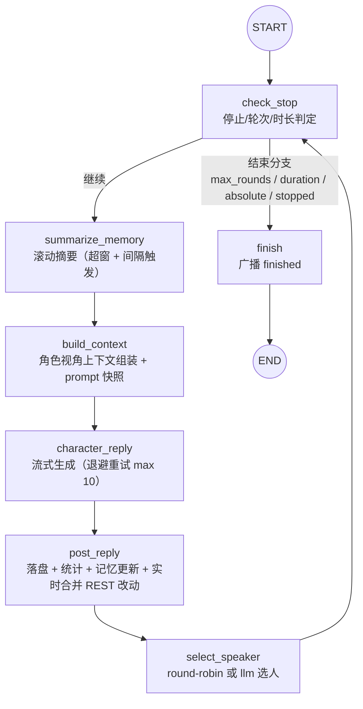
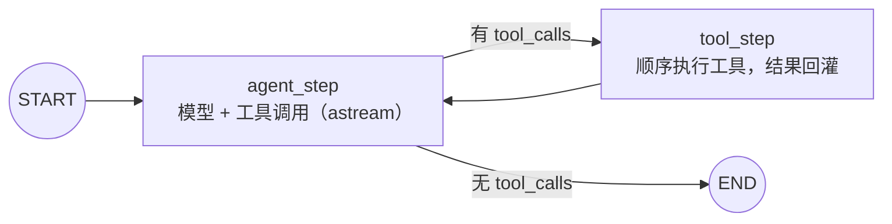

# duet-langgraph

duet 后端的 **Python 3.12 + FastAPI + LangGraph** 重写版。多 AI 自主对话聊天室：2~10 个角色按话题自动轮流对话，各自维护独立记忆（滚动摘要压缩），支持导演指令干预、资产库（角色/话题/世界观模板 + 关系图）与模型驱动的资产管理 Agent。

前端复用仓库根 `web/`（Vue 3），数据格式与 TS 版兼容（`providers.json` / `library.json` 可直接拷贝；**历史会话不迁移**，见下方差异清单）。

## 快速开始

```bash
# 方式一：uvx 直接跑（wheel 自带前端构建产物，一条命令同时提供 API 与页面）
uvx duet-langgraph

# 方式二：pip
pip install duet-langgraph
duet-langgraph          # http://localhost:23892，生产模式自动打开浏览器

# 方式三：仓库内 Docker Compose（一键构建前端 + 后端）
git clone git@github.com:honlnk/duet.git
cd duet && docker compose up -d --build
```

数据目录：`DATA_DIR` 环境变量最优先，默认 `~/.duet-langgraph`（Docker 镜像为 `/data`）。

API Key、模型、价格全部通过页面右上角「设置 → API 配置」维护，落盘到 `DATA_DIR/providers.json`，无需环境变量。

## 架构

主对话循环是一张 LangGraph StateGraph（`AsyncSqliteSaver` checkpointer 以 `sessionId` 为 thread 持久化，中断/重启可续跑）：



导演助手是独立的 Agent 图（SSE 输出 6 类事件：`delta` / `tool_call` / `tool_result` / `assistant` / `done` / `error`），挂载 12 个资产管理工具（角色/话题/世界观模板 CRUD + 关系图读写）：



运行时关键决策：

| 主题 | 决策 |
|---|---|
| 会话真源 | `DATA_DIR/sessions/duet.db`（sessions_meta 表，同步 sqlite3） |
| 图内状态 | `DATA_DIR/sessions/checkpoints.db`（AsyncSqliteSaver，与业务库分文件，规避跨线程写锁死锁） |
| 运行中热改 | REST 改动写 runtime 活跃会话，`_parse_session` 在每个节点入口合并（导演/关系/pacing/调度） |
| 模型接入 | langchain 官方类：openai / openai-responses / anthropic / gemini，thinking_config 原样透传 |
| WS 事件 | 15 类（sync/started/chunk/message_done/summary/stats/turn_end/…），与 TS 版契约一致 |

## 与 TS 版差异

| 项 | 说明 |
|---|---|
| 历史会话 | **不迁移**。TS 版会话存 JSON 文件、Python 版存 SQLite，升级后旧会话不可见（`providers.json` / `library.json` 可拷贝继续用） |
| pacing 阅读节奏 | 后端**不实现**（WS 事件契约中无对应事件；前端开关保留，切换无后端效果）。原因：TS 版实现与前端轮次联动强耦合，重写收益低 |
| 发言者调度 `scheduling: "llm"` | **新增**（TS 无）。建会话或 PATCH config 设 `scheduling: "llm"` 后由模型按对话内容选下一位发言者；解析失败/模型错误自动回落 round-robin |
| 发布物 | npm 包 `@honlnk/duet` → PyPI 包 `duet-langgraph`（wheel 自带前端产物） |
| 记忆持久化时机 | 每轮即存（TS 版在循环退出时存），中断丢得更少 |

## 环境变量

| 变量 | 默认 | 说明 |
|---|---|---|
| `PORT` | `23892` | 监听端口 |
| `DATA_DIR` | `~/.duet-langgraph` | 数据目录（providers/library/sessions） |
| `DUET_ENV` | 开发 `development` / 入口 `production` | 生产模式托管前端静态产物 |
| `DUET_STATIC_DIR` | 包内 `public/` | 前端构建产物目录（默认无需设置） |
| `ABSOLUTE_MAX_ROUNDS` | `200` | 全局硬熔断轮次 |
| `ABSOLUTE_MAX_DURATION_SEC` | `7200` | 全局硬熔断时长 |
| `REQUEST_TIMEOUT_MS` | `30000` | 单次模型请求超时 |

## 开发

```bash
cd server
uv sync                 # 安装依赖（含 dev）
uv run duet-langgraph   # 生产模式（需先构建前端：仓库根 pnpm --filter web build）
uv run uvicorn duet_langgraph.main:app --port 23892   # 开发模式（API/WS only）
uv run pytest           # 测试（40 项：REST 契约 / WS 事件 / Agent / 摘要 / 静态托管）
uv run ruff check .     # lint
```

前端开发：仓库根 `pnpm --filter web dev`（vite 46738，`/api` `/ws` 反代 23892）。

测试要点：fake-model 注入 + TestClient websocket 双向断言；`conftest.py` 以 `DATA_DIR` 指向 tmp 目录隔离数据。

## 发布

- 打 tag `v*`（须与 `pyproject.toml` version 一致）→ `.github/workflows/release-pypi.yml` 构建 wheel（含前端产物）并以 PyPI Trusted Publishing（OIDC）发布
- Docker：`server/Dockerfile` 三层构建（web → wheel → 运行层），根 `docker-compose.yml` 一键起
